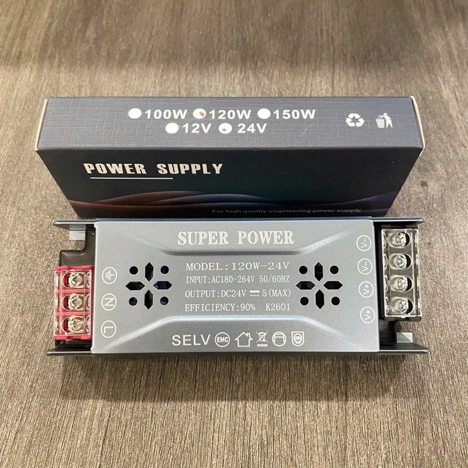
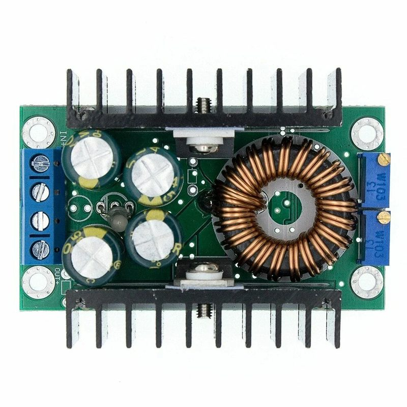
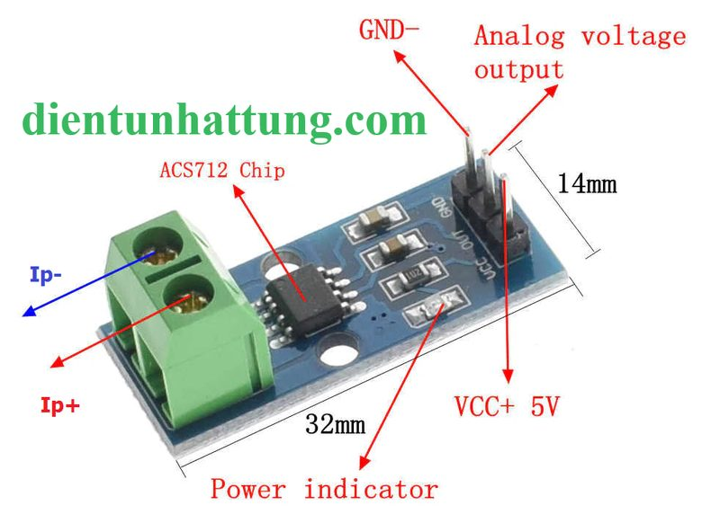
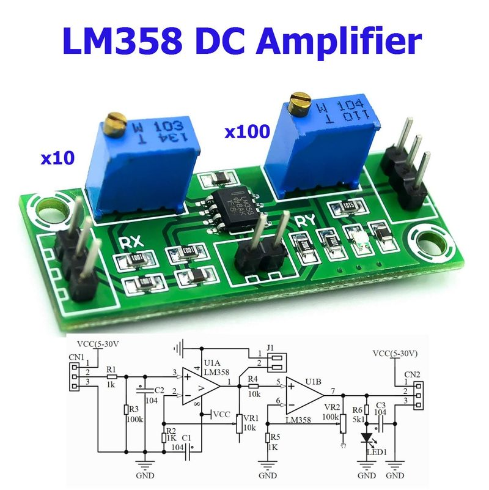
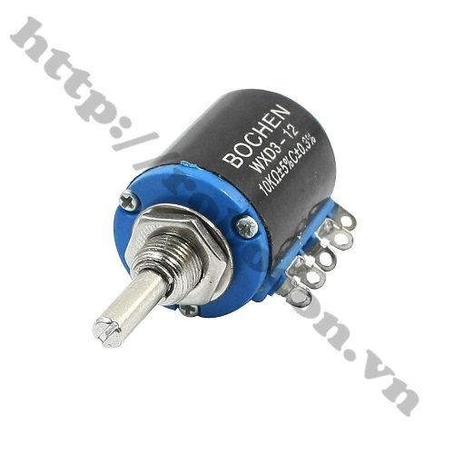
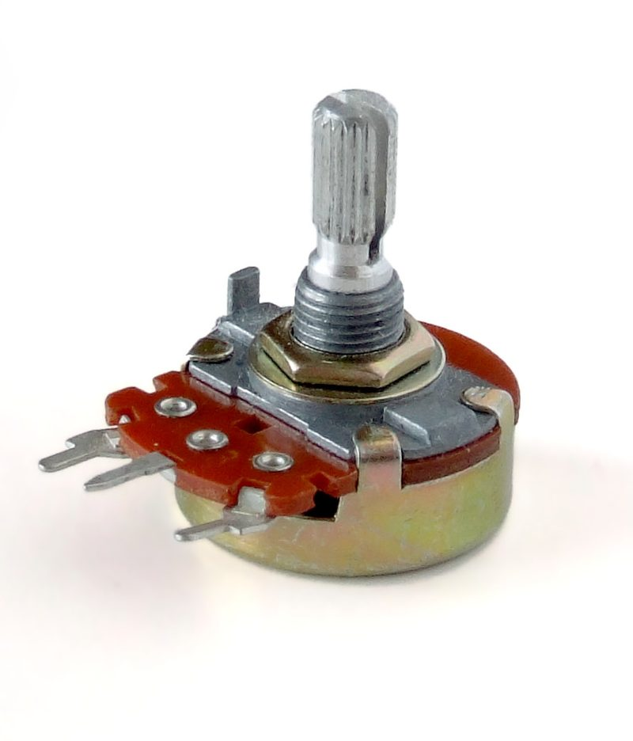

<div align="center">

# ⚡ NGUỒN ĐA NĂNG (Multi-Function DC Power Supply)

*Bench DC Power Supply + Voltmeter + Ammeter + Mini Oscilloscope*

**Vi điều khiển:** STM32F103C8T6 (Blue Pill) • **Màn hình:** TFT ST7789V 2.4" SPI

🎓 **Open Project — môn Linh Kiện Mạch Điện Tử** • Học viện Công nghệ Bưu chính Viễn thông (Bắc)


</div>

---


## 📖 Giới thiệu

Đây là dự án **bộ nguồn DC một chiều đa năng** tự chế, được thực hiện làm **open project của môn Linh Kiện Mạch Điện Tử** bởi nhóm 4 sinh viên (xem [Nhóm thực hiện](#-nhóm-thực-hiện)), dành cho **sinh viên năm nhất, năm hai** hoặc bất kỳ ai **đam mê chế đồ**. Thay vì mua một bộ nguồn bench giá hàng triệu đồng, dự án này dùng các module rẻ và dễ mua tại Việt Nam (XL4016, LM2596, ACS712...) kết hợp với vi điều khiển STM32 để tạo ra một thiết bị vừa **cấp nguồn chỉnh được 0 – 23V / tối đa 5A**, vừa **đo điện áp – dòng điện – công suất**, vừa **vẽ dạng sóng gợn AC** như một oscilloscope mini.

Toàn bộ mạch hàn tay trên **bo đục lỗ 5×7cm** — không cần PCB, không cần phần mềm thiết kế. Hướng dẫn trong repo viết theo phong cách **"đọc tên là biết bốc con gì"** — mỗi bước hàn đều ghi rõ linh kiện gì nối vào chân nào, kèm điểm kiểm tra bằng VOM (đồng hồ vạn năng) sau mỗi bước. Nếu bạn chưa từng hàn mạch nào, đây là dự án khởi đầu rất phù hợp.

> ⚠️ **Cảnh báo an toàn:** Phần 220V AC là phần nguy hiểm duy nhất của dự án. Hãy đọc [docs/01-an-toan.md](docs/01-an-toan.md) **trước khi** bắt đầu bất cứ việc gì.

## ✨ Tính năng chính

| Tính năng | Thông số | Ghi chú |
|---|---|---|
| 🔌 Cấp nguồn DC chỉnh áp | 0 – 23V, tối đa 5A | Giới hạn bởi nguồn 24V/5A vào • Volt: chiết áp 10 vòng WXD3, Dòng: chiết áp thường 10k |
| 📊 Đo điện áp | 0 – 30V | Hiển thị sai số ~1% sau hiệu chỉnh |
| 📊 Đo dòng điện | ±5A (ACS712-05B) | Qua cảm biến Hall, không cần ngắt mạch |
| 📊 Đo công suất | V × I tính trực tiếp | Hiển thị cùng màn hình chính |
| 〰️ Đo gợn sóng AC | Qua module khuếch đại LM358 2 tầng | Gain chỉnh bằng biến trở, xem dạng sóng trên oscilloscope mini |
| 📺 Màn hình TFT 2.4" | 240×320, giao tiếp SPI | Giao diện dashboard + oscilloscope |
| 🎛️ 4 nút bấm | MODE / CHANNEL / TIME/DIV / HOLD | Điều khiển hoàn toàn bằng tay |
| ❄️ Quạt tản nhiệt 5V | Tự cấp từ LM2596 | Bảo vệ module công suất XL4016 |

## 🧩 Sơ đồ khối hệ thống

Tín hiệu và dòng năng lượng đi qua 4 giai đoạn:

1. **Nguồn vào (AC):** Ổ cắm 3 chân có công tắc + cầu chì 2A → nguồn vỏ nhôm 24V/5A (120W)
2. **Hạ áp:** XL4016 hạ 24V xuống 0 – 23V ra tải • LM2596 hạ 24V xuống 5V nuôi mạch điều khiển
3. **Đo & xử lý:** STM32F103C8T6 đọc 3 kênh ADC (Volt / Dòng / Gợn AC)
4. **Hiển thị & điều khiển:** Màn hình TFT + 4 nút nhấn + cọc bắp chuối ra tải

## ⚡ Sơ đồ nguyên lý mạch

Sơ đồ mạch chi tiết kiểu schematic — thể hiện **mọi nối dây thật** của dự án: đường công suất 24V, đường 5V, 3 kênh đo (PA0/PA1/PA2), cầu phân áp, 2 chiết áp, module LM358 2 tầng, TFT và 4 nút nhấn. Mỗi nối dây trong hình đều khớp 100% với bảng chân ở [docs/03-bang-chan-stm32.md](docs/03-bang-chan-stm32.md) và 14 bước hàn ở [docs/04-huong-dan-lap-rap.md](docs/04-huong-dan-lap-rap.md).


## 📍 Sơ đồ chân STM32


Chi tiết đầy đủ (kèm giá trị linh kiện cầu đo): [docs/03-bang-chan-stm32.md](docs/03-bang-chan-stm32.md)

## 🗂️ Cấu trúc repo

```
nguon-dc-da-nang/
├── README.md                  ← Bạn đang đọc file này
├── README_EN.md               ← Bản tiếng Anh (tóm tắt)
├── LICENSE                    ← Giấy phép MIT
├── CHANGELOG.md               ← Lịch sử thay đổi các phiên bản
├── CONTRIBUTING.md            ← Hướng dẫn đóng góp
├── HUONG-DAN-GITHUB.md        ← Hướng dẫn tự upload repo cho người mới
├── docs/                      ← Tài liệu kỹ thuật
│   ├── 01-an-toan.md          ← Quy tắc an toàn (đọc đầu tiên!)
│   ├── 02-danh-sach-linh-kien.md  ← BOM: danh sách linh kiện cần mua
│   ├── 03-bang-chan-stm32.md  ← Bảng nối chân chi tiết
│   ├── 04-huong-dan-lap-rap.md← 14 bước hàn từng mối nối
│   ├── 05-huong-dan-nap-code.md   ← Cài PlatformIO (VS Code) / Arduino IDE + nạp code
│   └── 06-hieu-chinh.md       ← Hiệu chỉnh độ chính xác đo
├── firmware/                  ← Code nguồn
│   ├── README.md              ← Cấu trúc firmware + 2 cách build
│   ├── platformio.ini         ← Cấu hình PlatformIO — mở thư mục firmware/ bằng VS Code là build được
│   └── nguon_dc_da_nang/
│       └── nguon_dc_da_nang.ino   ← Chương trình chính
├── hardware/                  ← Ghi chú phần cứng (bo đục lỗ 5×7cm)
└── images/                    ← Ảnh minh họa dùng trong README
```


## 📚 Tài liệu

| Tài liệu | Nội dung | Dành cho ai |
|---|---|---|
| [An toàn điện](docs/01-an-toan.md) | 3 việc bắt buộc + 1 việc cấm khi làm 220V | Bắt buộc đọc trước tiên |
| [Danh sách linh kiện](docs/02-danh-sach-linh-kien.md) | BOM đầy đủ: module, trở, tụ, cơ khí | Ai chuẩn bị mua đồ |
| [Bảng chân STM32](docs/03-bang-chan-stm32.md) | Chân nào nối đi đâu, kèm giá trị linh kiện | Ai đang hàn mạch |
| [Hướng dẫn lắp ráp](docs/04-huong-dan-lap-rap.md) | 14 bước hàn, mỗi bước có điểm kiểm tra | Ai đang hàn mạch |
| [Hướng dẫn nạp code](docs/05-huong-dan-nap-code.md) | Cài VS Code + PlatformIO (hoặc Arduino IDE) + ST-Link từ số 0 | Người mới đụng STM32 |
| [Hiệu chỉnh](docs/06-hieu-chinh.md) | Cân sai số đo áp / đo dòng | Mạch hàn xong, chạy tốt |
| [Hướng dẫn GitHub](HUONG-DAN-GITHUB.md) | Đưa dự án này lên GitHub từng bước | Người mới dùng GitHub |

## 🚀 Bắt đầu nhanh

1. **Mua linh kiện** theo [docs/02-danh-sach-linh-kien.md](docs/02-danh-sach-linh-kien.md) (~700.000đ – 900.000đ tùy nơi mua)
2. **Đọc quy tắc an toàn** [docs/01-an-toan.md](docs/01-an-toan.md) — không bỏ qua bước này
3. **Hàn mạch** theo [docs/04-huong-dan-lap-rap.md](docs/04-huong-dan-lap-rap.md), kiểm tra VOM sau mỗi bước
4. **Nạp firmware** theo [docs/05-huong-dan-nap-code.md](docs/05-huong-dan-nap-code.md)
5. **Hiệu chỉnh** độ chính xác theo [docs/06-hieu-chinh.md](docs/06-hieu-chinh.md)

## 🧰 Linh kiện thật

Ảnh chụp thực tế một số linh kiện chính của bộ nguồn:

| Nguồn 24V/5A "tổ ong" vỏ nhôm (hiệu suất 90%) | Module XL4016 (hạ áp công suất) | Module ACS712 5A (đo dòng) |
|---|---|---|
|  |  |  |
| **Module LM358 2 tầng** (khuếch đại gợn AC) | **Chiết áp 10 vòng WXD3 10kΩ** (chỉnh Volt) | **Chiết áp thường 10kΩ** (chỉnh Dòng) |
|  |  |  |

> 📷 *Ảnh mạch thật trên bo đục lỗ và ảnh màn hình đang chạy sẽ được bổ sung sau khi hoàn thiện lắp ráp.*

## 👥 Nhóm thực hiện

Dự án được thực hiện bởi **nhóm 4 sinh viên** dưới sự hướng dẫn của giảng viên môn **Linh Kiện Mạch Điện Tử** — Học viện Công nghệ Bưu chính Viễn thông (Bắc).

| STT | Thành viên | MSSV | Vai trò trong nhóm | GitHub |
|---|---|---|---|---|
| 1 | *[Họ tên thành viên 1]* | *[MSSV]* | Trưởng nhóm • Thiết kế mạch & lắp ráp | *@username* |
| 2 | *[Họ tên thành viên 2]* | *[MSSV]* | Firmware & lập trình STM32 | *@username* |
| 3 | *[Họ tên thành viên 3]* | *[MSSV]* | Kiểm thử • Hiệu chỉnh & đo đạc | *@username* |
| 4 | *[Họ tên thành viên 4]* | *[MSSV]* | Tài liệu • Ảnh & video dự án | *@username* |

> 🧑‍🏫 **Giảng viên hướng dẫn:** *[Tên thầy/cô]* — môn Linh Kiện Mạch Điện Tử.

<!-- ✏️ TODO: điền tên thật, MSSV, GitHub và tên giảng viên vào bảng trên -->

## 🤝 Đóng góp

Dự án làm trong lúc học nên khó tránh khỏi sai sót. Nếu bạn phát hiện lỗi trong tài liệu hoặc code — hoặc đã lắp thành công và muốn chia sẻ cải tiến — cứ mở [Issue](../../issues) hoặc gửi Pull request. Xem thêm [CONTRIBUTING.md](CONTRIBUTING.md).

## 📄 License

Dự án được phát hành theo giấy phép **MIT** — bạn được phép sử dụng, sửa đổi, chia sẻ tự do, kể cả cho mục đích thương mại, miễn là giữ nguyên dòng bản quyền. Xem [LICENSE](LICENSE) để biết chi tiết.

---

<div align="center">

*Made with 🔧 by **Nhóm [tên nhóm] — Linh Kiện Mạch Điện Tử** • Học viện Công nghệ Bưu chính Viễn thông (Bắc)* <!-- TODO: thay [tên nhóm] bằng tên nhóm của bạn -->

**Nếu dự án hữu ích với bạn, hãy ⭐ star repo này nhé!**

</div>
