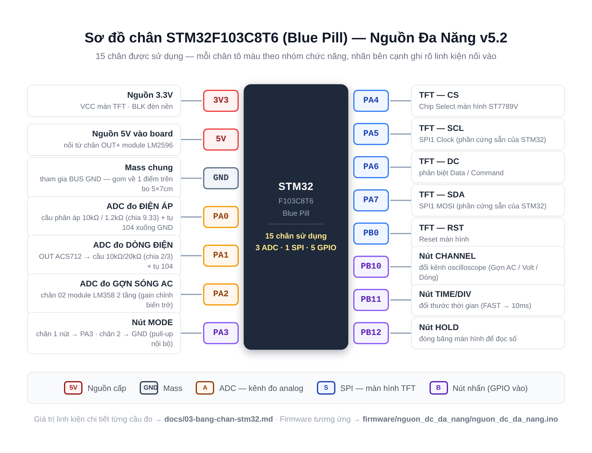
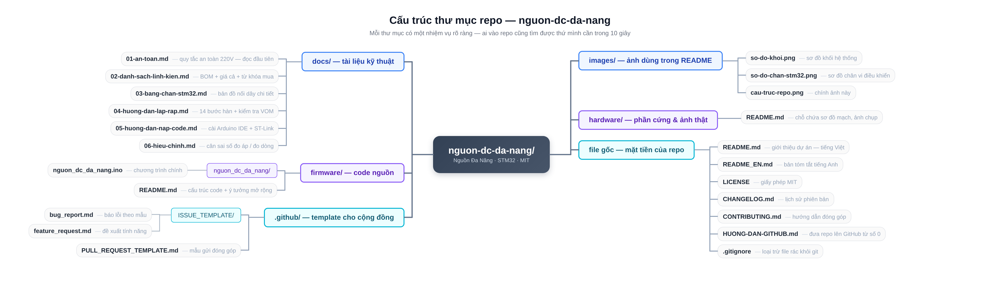

<div align="center">

# ⚡ NGUỒN ĐA NĂNG (Multi-Function DC Power Supply)

*Bench DC Power Supply + Voltmeter + Ammeter + Mini Oscilloscope*

**Vi điều khiển:** STM32F103C8T6 (Blue Pill) • **Màn hình:** TFT ST7789V 2.4" SPI


</div>

---


## 📖 Giới thiệu

Đây là dự án **bộ nguồn DC một chiều đa năng** tự chế, dành cho sinh viên và người mới học điện tử. Thay vì mua một bộ nguồn bench thương giá hàng triệu đồng, dự án này dùng các module rẻ và dễ mua tại Việt Nam (XL4016, LM2596, ACS712...) kết hợp với vi điều khiển STM32 để tạo ra một thiết bị vừa **cấp nguồn chỉnh được 0.8–22V / tối đa 8A**, vừa **đo điện áp – dòng điện – công suất**, vừa **vẽ dạng sóng gợn AC** như một oscilloscope mini.

Toàn bộ hướng dẫn trong repo được viết theo phong cách **"đọc tên là biết bốc con gì"** — mỗi bước hàn đều ghi rõ linh kiện gì nối vào chân nào, kèm điểm kiểm tra bằng VOM (đồng hồ vạn năng) sau mỗi bước. Nếu bạn là sinh viên năm nhất, chưa từng hàn mạch nào, đây là dự án khởi đầu rất phù hợp.

> ⚠️ **Cảnh báo an toàn:** Phần 220V AC là phần nguy hiểm duy nhất của dự án. Hãy đọc [docs/01-an-toan.md](docs/01-an-toan.md) **trước khi** bắt đầu bất cứ việc gì.

## ✨ Tính năng chính

| Tính năng | Thông số | Ghi chú |
|---|---|---|
| 🔌 Cấp nguồn DC chỉnh áp | 0.8 – 22V, tối đa 8A | Điều chỉnh bằng chiết áp 10 vòng |
| 📊 Đo điện áp | 0 – 30V | Hiển thị sai số ~1% sau hiệu chỉnh |
| 📊 Đo dòng điện | ±5A (ACS712-05B) | Qua cảm biến Hall, không cần ngắt mạch |
| 📊 Đo công suất | V × I tính trực tiếp | Hiển thị cùng màn hình chính |
| 〰️ Đo gợn sóng AC | Qua module khuếch đại LM358 2 tầng | Gain chỉnh bằng biến trở, xem dạng sóng trên oscilloscope mini |
| 📺 Màn hình TFT 2.4" | 240×320, giao tiếp SPI | Giao diện dashboard + oscilloscope |
| 🎛️ 4 nút bấm | MODE / CHANNEL / TIME/DIV / HOLD | Điều khiển hoàn toàn bằng tay |
| ❄️ Quạt tản nhiệt 5V | Tự cấp từ LM2596 | Bảo vệ module công suất XL4016 |

## 🧩 Sơ đồ khối hệ thống

Tín hiệu và dòng năng lượng đi qua 4 giai đoạn:

1. **Nguồn vào (AC):** Ổ cắm 3 chân có công tắc + cầu chì 2A → nguồn vỏ nhôm 24V/5A (120W)
2. **Hạ áp:** XL4016 (8A) hạ 24V xuống 0.8–22V ra tải • LM2596 hạ 24V xuống 5V nuôi mạch điều khiển
3. **Đo & xử lý:** STM32F103C8T6 đọc 3 kênh ADC (Volt / Dòng / Gợn AC)
4. **Hiển thị & điều khiển:** Màn hình TFT + 4 nút nhấn + cọc bắp chuối ra tải

## 📍 Sơ đồ chân STM32



Chi tiết đầy đủ (kèm giá trị linh kiện cầu đo): [docs/03-bang-chan-stm32.md](docs/03-bang-chan-stm32.md)

## 🗂️ Cấu trúc repo

```
nguon-dc-da-nang/
├── README.md                  ← Bạn đang đọc file này
├── README_EN.md               ← Bản tiếng Anh (tóm tắt)
├── LICENSE                    ← Giấy phép MIT
├── CHANGELOG.md               ← Lịch sử thay đổi các phiên bản
├── CONTRIBUTING.md            ← Hướng dẫn đóng góp
├── HUONG-DAN-GITHUB.md        ← Hướng dẫn tự upload repo cho người mới
├── docs/                      ← Tài liệu kỹ thuật
│   ├── 01-an-toan.md          ← Quy tắc an toàn (đọc đầu tiên!)
│   ├── 02-danh-sach-linh-kien.md  ← BOM: danh sách linh kiện cần mua
│   ├── 03-bang-chan-stm32.md  ← Bảng nối chân chi tiết
│   ├── 04-huong-dan-lap-rap.md← 14 bước hàn từng mối nối
│   ├── 05-huong-dan-nap-code.md   ← Cài Arduino IDE + nạp code
│   └── 06-hieu-chinh.md       ← Hiệu chỉnh độ chính xác đo
├── firmware/                  ← Code nguồn
│   ├── README.md              ← Hướng dẫn cài môi trường Arduino
│   └── nguon_dc_da_nang/
│       └── nguon_dc_da_nang.ino   ← Chương trình chính
├── hardware/                  ← Sơ đồ mạch, ảnh chụp (đang cập nhật)
└── images/                    ← Ảnh minh họa dùng trong README
```



## 📚 Tài liệu

| Tài liệu | Nội dung | Dành cho ai |
|---|---|---|
| [An toàn điện](docs/01-an-toan.md) | 3 việc bắt buộc + 1 việc cấm khi làm 220V | Bắt buộc đọc trước tiên |
| [Danh sách linh kiện](docs/02-danh-sach-linh-kien.md) | BOM đầy đủ: module, trở, tụ, cơ khí | Ai chuẩn bị mua đồ |
| [Bảng chân STM32](docs/03-bang-chan-stm32.md) | Chân nào nối đi đâu, kèm giá trị linh kiện | Ai đang hàn mạch |
| [Hướng dẫn lắp ráp](docs/04-huong-dan-lap-rap.md) | 14 bước hàn, mỗi bước có điểm kiểm tra | Ai đang hàn mạch |
| [Hướng dẫn nạp code](docs/05-huong-dan-nap-code.md) | Cài Arduino IDE + STM32 + ST-Link từ số 0 | Người mới đụng STM32 |
| [Hiệu chỉnh](docs/06-hieu-chinh.md) | Cân sai số đo áp / đo dòng | Mạch hàn xong, chạy tốt |
| [Hướng dẫn GitHub](HUONG-DAN-GITHUB.md) | Đưa dự án này lên GitHub từng bước | Người mới dùng GitHub |

## 🚀 Bắt đầu nhanh

1. **Mua linh kiện** theo [docs/02-danh-sach-linh-kien.md](docs/02-danh-sach-linh-kien.md) (~700.000đ – 900.000đ tùy nơi mua)
2. **Đọc quy tắc an toàn** [docs/01-an-toan.md](docs/01-an-toan.md) — không bỏ qua bước này
3. **Hàn mạch** theo [docs/04-huong-dan-lap-rap.md](docs/04-huong-dan-lap-rap.md), kiểm tra VOM sau mỗi bước
4. **Nạp firmware** theo [docs/05-huong-dan-nap-code.md](docs/05-huong-dan-nap-code.md)
5. **Hiệu chỉnh** độ chính xác theo [docs/06-hieu-chinh.md](docs/06-hieu-chinh.md)

## 📷 Ảnh dự án

> 🚧 *Sắp có — mình sẽ chụp và bổ sung ảnh mạch thật khi hoàn thiện. Bạn cũng có thể chèn ảnh của bạn vào đây.*

<!-- Gợi ý: chụp 3 loại ảnh: (1) mạch trên bo cấn trước khi lắp hộp, (2) mặt trước hộp có màn hình bật,
(3) ảnh màn hình đang hiển thị số đo. Đặt file vào thư mục images/ rồi thay dòng dưới đây -->
<!--  -->

## 🗺️ Lộ trình phát triển

- [x] v5.1 — Bản lắp ráp bằng module cấn
- [x] v5.2 — Thay mạch LM358 rời bằng module LM358 2 tầng (hiện tại)
- [ ] v6.0 — Thiết kế PCB riêng, thay bo cấn
- [ ] v6.1 — Thêm chỉnh áp/dòng bằng encoder + menu trên màn hình
- [ ] v6.2 — Cổng USB gửi số liệu lên máy tính (Serial plotter)
- [ ] v7.0 — Dựng vỏ 3D in, file STL công khai

## 🤝 Đóng góp

Mọi đóng góp đều được chào đón — kể cả sửa lỗi chính tả! Xem [CONTRIBUTING.md](CONTRIBUTING.md) để bắt đầu. Nếu bạn phát hiện lỗi hoặc có ý tưởng mới, tạo [Issue](../../issues) với template có sẵn.

## 📄 License

Dự án được phát hành theo giấy phép **MIT** — bạn được phép sử dụng, sửa đổi, chia sẻ tự do, kể cả cho mục đích thương mại, miễn là giữ nguyên dòng bản quyền. Xem [LICENSE](LICENSE) để biết chi tiết.

---

<div align="center">

*Made with 🔧 by a PTIT student — Học viện Công nghệ Bưu chính Viễn thông ( Bắc )* <!-- TODO: thay bằng tên/username GitHub của bạn -->

**Nếu dự án hữu ích với bạn, hãy ⭐ star repo này nhé!**

</div>
