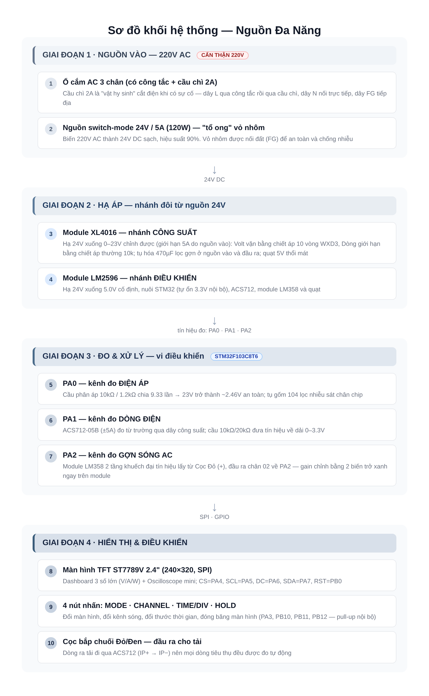
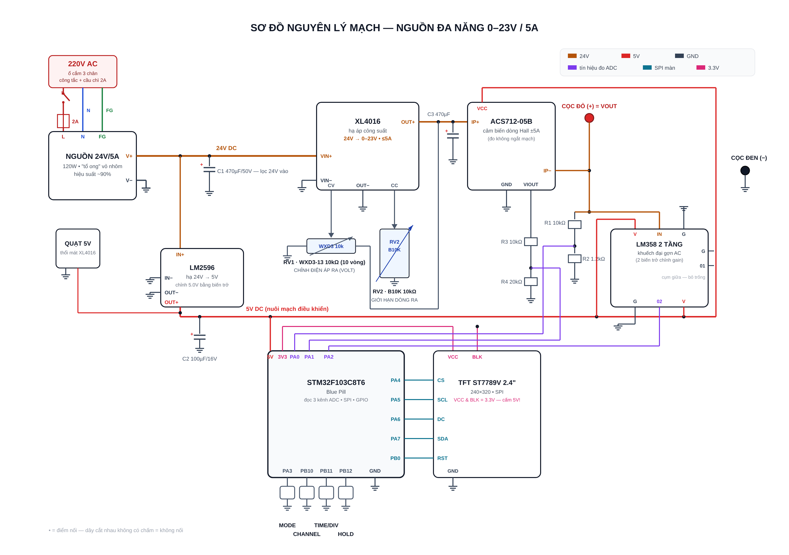

<div align="center">

# ⚡ Multi-Function DC Power Supply

*English summary — see the [Vietnamese README](README.md) for the full documentation*

🎓 **Open Project — Electronic Circuit Components (Linh Kiện Mạch Điện Tử) course** • Posts and Telecommunications Institute of Technology (PTIT), Hanoi


</div>

## Overview

A DIY bench DC power supply built entirely from cheap, easy-to-find modules — designed for **first- and second-year students** and **DIY makers**. It combines an **adjustable 0 – 23V / 5A power output** (limited by the 24V/5A input PSU), a **voltmeter**, an **ammeter**, and a **mini oscilloscope** for AC ripple, all driven by an STM32F103C8T6 (Blue Pill) with a 2.4" TFT display.

The whole circuit is hand-soldered on a **5×7cm perfboard** — no custom PCB, no design software needed. Total cost is roughly **USD 30–40**.

## Key Features

| Feature | Specification |
|---|---|
| Adjustable DC output | 0 – 23V, up to 5A (limited by the 24V/5A input PSU) — WXD3 10-turn pot for voltage, regular 10k pot for current limit |
| Voltage measurement | 0 – 30V via resistor divider on ADC PA0 |
| Current measurement | ±5A via ACS712-05B Hall sensor on ADC PA1 |
| Power display | V × I computed on the MCU |
| AC ripple scope | 2-stage LM358 amplifier module with adjustable gain, sampled on ADC PA2 |
| Display | 2.4" TFT ST7789V, 240×320, SPI |
| Controls | 4 push buttons: MODE / CHANNEL / TIME-DIV / HOLD |
| Auxiliary | 5V fan for heatsink cooling, LM2596 for logic supply |

## System Block Diagram



**Power flow:** 220V AC (switched socket + 2A fuse) → 24V/5A enclosed PSU → two branches:
1. **XL4016** step-down → adjustable output → ACS712 → output terminals
2. **LM2596** step-down → 5V logic rail → STM32, TFT, fan

**Measurement path:** output voltage (10k/1.2k divider) → PA0 • ACS712 output → PA1 • AC ripple (2-stage LM358 module, output pin 02) → PA2.

## Circuit Schematic

Full schematic-style wiring diagram — every connection matches the pin table and the 14-step assembly guide:



## Repository Structure

```
nguon-dc-da-nang/
├── README.md / README_EN.md   # This documentation
├── LICENSE                    # MIT License
├── docs/                      # Safety rules, BOM, pin table,
│                              # 14-step assembly guide, firmware
│                              # flashing guide, calibration
├── firmware/                  # platformio.ini (PlatformIO/VS Code config) +
│   │                          # Arduino sketch nguon_dc_da_nang.ino (STM32duino core)
├── hardware/                  # Hardware notes (perfboard build)
└── images/                    # Diagrams used in the README
```

## Getting Started

1. **Buy the parts** — full BOM in [docs/02-danh-sach-linh-kien.md](docs/02-danh-sach-linh-kien.md) (Vietnamese)
2. **Read the safety rules** — [docs/01-an-toan.md](docs/01-an-toan.md) (mains voltage warning!)
3. **Solder the circuit** — 14 guided steps in [docs/04-huong-dan-lap-rap.md](docs/04-huong-dan-lap-rap.md)
4. **Flash the firmware** — VS Code + PlatformIO (recommended) or Arduino IDE setup in [docs/05-huong-dan-nap-code.md](docs/05-huong-dan-nap-code.md)
5. **Calibrate** — [docs/06-hieu-chinh.md](docs/06-hieu-chinh.md)

## Pin Map (summary)

| Pin | Connected to | Function |
|---|---|---|
| PA0 | 10kΩ / 1.2kΩ divider | ADC — voltage sense |
| PA1 | ACS712 via 10k/20k divider | ADC — current sense |
| PA2 | 2-stage LM358 module (output pin 02) | ADC — AC ripple |
| PA3 / PB10 / PB11 / PB12 | Push buttons (to GND) | MODE / CHANNEL / TIME-DIV / HOLD |
| PA4 / PA5 / PA6 / PA7 / PB0 | TFT | CS / SCK / DC / MOSI / RST |

Full table with component values: [docs/03-bang-chan-stm32.md](docs/03-bang-chan-stm32.md)

## Team

The project is built by a **team of 4 students** as an open course project for **Electronic Circuit Components (Linh Kiện Mạch Điện Tử)**, under the guidance of the course instructor at PTIT.

| # | Member | Student ID | Role | GitHub |
|---|---|---|---|---|
| 1 | *[Full name 1]* | *[ID]* | Team lead • Circuit design & assembly | *@username* |
| 2 | *[Full name 2]* | *[ID]* | Firmware & STM32 programming | *@username* |
| 3 | *[Full name 3]* | *[ID]* | Testing • Calibration & measurements | *@username* |
| 4 | *[Full name 4]* | *[ID]* | Documentation • Photos & videos | *@username* |

> 🧑‍🏫 **Instructor:** *[Name]* — Electronic Circuit Components course.

<!-- ✏️ TODO: fill in real names, student IDs, GitHub usernames and instructor name -->

## License

Released under the [MIT License](LICENSE) — free to use, modify and share, including commercially, as long as the copyright notice is kept.
